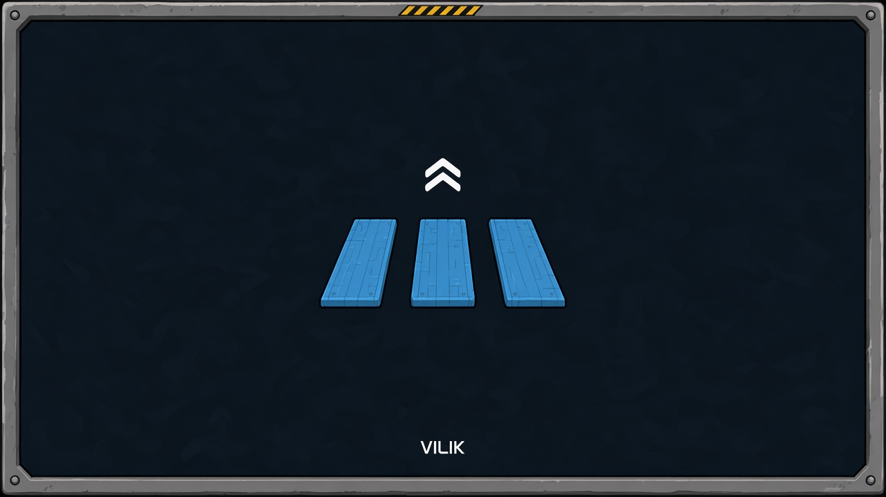

# Creative mode



Need creative mode? Build anything you can imagine without grinding for a single material.

Pick Creative when you create a new world and you get:
- Free building: no materials needed and all research unlocked
- No health or oxygen to worry about
- Fly freely: double-tap Space to toggle flight
- Your tools ready in the quick bar
- Middle-click with the build tool to pick the part you are looking at
- Shift-click to stack hull blocks in a line, scroll to set the length (up to 16)
- Ctrl+Z to undo and Ctrl+Y to redo placements
- Refill wood thrusters, generators and distillers, or give them infinite fuel

MelonLoader mod for Stellar Drive.

## Installation

Install it from the Stellar Mod Manager, or copy `CreativeMod.dll` from the latest release into the game's `Mods` folder. The game needs MelonLoader.

A creative world is marked by a `creative.mode` file in the save folder. A world without that file plays as survival.

## Building from source

You need the .NET SDK (any version that can build `net472` projects) and Stellar Drive with MelonLoader installed. The project references the game's own assemblies, so nothing from the game is included in this repository.

```
dotnet build src/CreativeMode.csproj -c Release -p:GameDir="C:\Program Files (x86)\Steam\steamapps\common\StellarDrive Demo"
```

The DLL ends up in `src/bin/Release`. Add `-p:CopyToMods=true` to copy it into the game's `Mods` folder.

## How the code is organised

| File | What it does |
| --- | --- |
| `CreativeModeMod.cs` | Mod entry point: scene load, research, journal and the vital-stat passes |
| `CreativeSession.cs` | Writes and reads the `creative.mode` file so a world stays creative after a save |
| `ModePicker.cs` | The Creative / Survival dialog before a new world is created |
| `GameText.cs` | Localized strings taken from the game |
| `CreativePatches.cs` | Tools, free build, health, oxygen, collision damage and the tutorial |
| `CreativeFlight.cs` | Double-tap Space to fly, and the patches that keep flying usable |
| `CreativeCatalog.cs` | Unlocks every part and feature and ignores build costs |
| `CreativeResearch.cs` | Unlocks research |
| `CreativeJournal.cs` | Marks journal entries as read |
| `PickLookedAtPart.cs` | Middle-click picks the part you are looking at |
| `BuildLine.cs` | Shift-click stacks hull blocks in a line |
| `BuildUndo.cs` | Ctrl+Z and Ctrl+Y for placements and cables |
| `FuelCreative.cs` | Refill or infinite fuel on wood thrusters, generators and distillers |
| `Shared/GameKeys.cs` | Keeps the mod's keys away from the chat, text fields and game menus |

## License

MIT, see [LICENSE](LICENSE).
